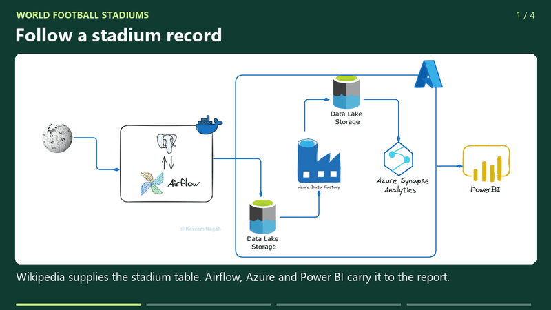
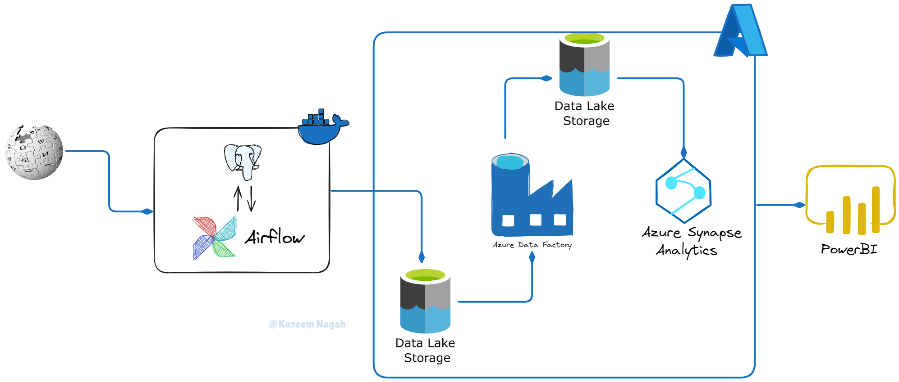
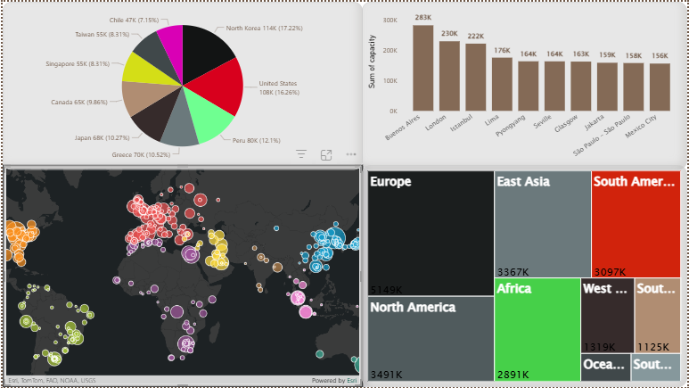
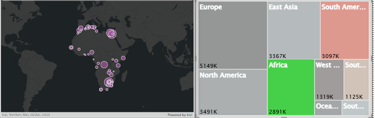
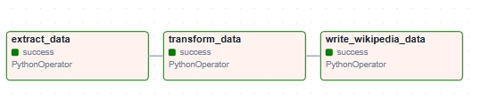
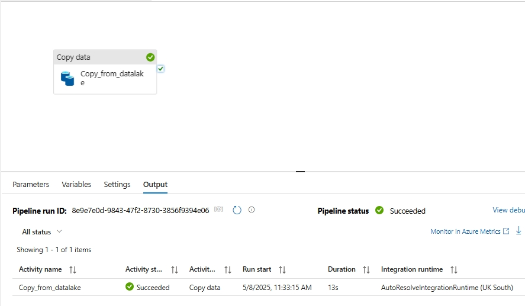
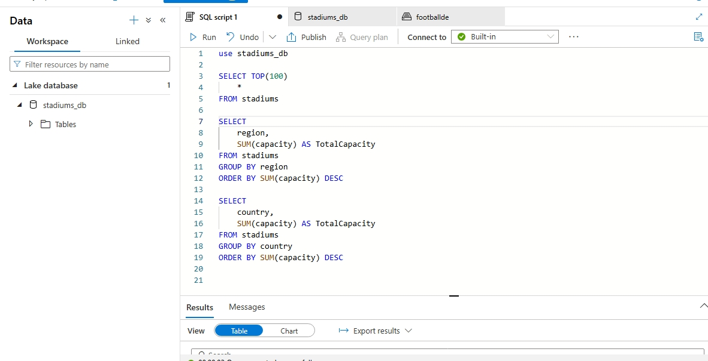
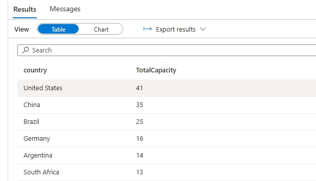

# 🏟️ E2E Football Stadiums Data Pipeline

An end-to-end data engineering pipeline that extracts, transforms, enriches, and analyzes football stadium data from Wikipedia. This project utilizes web scraping, data transformation, geocoding, cloud storage, and data warehousing to enable robust analytics and reporting using Azure Synapse and Power BI.

## Pipeline walkthrough

[](docs/media/pipeline-tour.mp4)

[Watch the video](docs/media/pipeline-tour.mp4) · [View the static architecture diagram](images/Architecture.png)

---

## 📚 Table of Contents

* [🚀 Project Architecture](#-project-architecture)
* [📊 Workflow Diagram](#-workflow-diagram)
* [⚙️ Technologies Used](#%ef%b8%8f-technologies-used)
* [📂 Project Structure](#-project-structure)
* [🔧 Setup Instructions](#-setup-instructions)

  * [🔹 Prerequisites](#-prerequisites)
  * [🔹 Local Airflow Setup (Docker-Based)](#-local-airflow-setup-docker-based)
  * [🔹 Configure Azure Blob Storage](#-configure-azure-blob-storage)
  * [🔹 Azure Data Factory](#-azure-data-factory)
  * [🔹 Azure Synapse Setup](#-azure-synapse-setup)
  * [🔹 Power BI Dashboard](#-power-bi-dashboard)
* [📊 Simple Dashboard](#-simple-dashboard)
* [📌 Visuals](#-visuals)
  * [📌 Airflow DAG](#-airflow-dag)
  * [📌 Azure Data Factory](#-azure-data-factory)
  * [📌 Synapse SQL Query](#-synapse-sql-query)
* [🤝 Credits](#-credits)
* [📄 License](#-license)
  
---
## 🚀 Project Architecture



This pipeline is orchestrated using Apache Airflow and includes the following stages:

1. **Extraction**: Scrapes football stadium data from Wikipedia.
2. **Transformation**: Cleans and enriches the data using Pandas.
3. **Geocoding**: Retrieves latitude and longitude for stadiums using external geocoding services.
4. **Storage**: Uploads cleaned data to Azure Blob Storage.
5. **Data Factory & Synapse**: Processes data through Azure Data Factory into Azure Synapse for further analytics.
6. **Visualization**: Generates insightful dashboards using Power BI.

---

## 📊 Workflow Diagram


---

## ⚙️ Technologies Used

* **Airflow** – Orchestration and scheduling
* **Docker** – Containerized pipeline deployment
* **LXML + XPath** - HTML parsing
* **Python** – Data extraction and transformation (Pandas, Requests, LXML)
* **PostgreSQL** – Metadata and logging support
* **Geocoding API** – Enrichment with coordinates
* **Azure Blob Storage / Azure Data Lake Gen2** - data storage
* **Azure Data Factory** – ETL pipeline automation
* **Azure Synapse Analytics** – Data warehousing and processing
* **Power BI** – Dashboard and reporting

---

## 📂 Project Structure

```
├── docker-compose.yml
├── Dockerfile
├── LICENCE
├── README.md
├── dags
│   ├── __init__.py
│   └── wikipedia_flow.py
├── data/
├── logs
├── pipeline_testing.ipynb
├── pipelines
│   ├── __init__.py
│   ├── geocoding.py
│   └── wikipedia_pipeline.py
├── postgres_data 
└── requirements.txt
```
--- 

## 🔧 Setup Instructions

### 🔹 Prerequisites

* Azure Subscription
* Azure Storage Account with Data Lake Gen2 enabled
* Azure Synapse Workspace
* Azure Data Factory
* Power BI Desktop
* Docker + Docker Compose (for Airflow)

### 🔹 Local Airflow Setup (Docker-Based)

#### 1. Clone the repo

```bash
git clone https://github.com/kareemNagah/E2E_FootBall_Stadiums_Pipeline.git
cd E2E_FootBall_Stadiums_Pipeline
```

#### 2. Run Airflow using Docker

```bash
docker-compose up -d --build
```

#### 3. Access Airflow UI

Go to `http://localhost:8080` and trigger the DAG: `wikipedia_stadiums_pipeline`.


### 🔹 Configure Azure Blob Storage

1. Create a Storage Account with Hierarchical namespace enabled.

2. Create a Container (e.g., stadiums-data).

3. Generate a SAS token or use Azure credentials for access.

4. Update environment variables or Airflow connections for access.

### 🔹 Azure Data Factory

1. Create a new pipeline with a Copy Data activity.
2. Source: Configure the dataset to point to your Azure Data Lake file.
3. Sink: Configure Azure Synapse Analytics as destination.

### 🔹 Azure Synapse Setup

1. Create a serverless SQL pool
2. Create a table schema matching the stadiums CSV
3. Connect Power BI to Synapse for querying and visualization

### 🔹 Power BI Dashboard

* Use **Azure Blob Storage endpoint** as data source
* Create visualisations 

---

## 📊 Simple Dashboard 


<p align = "center" >
   
</p>

* Filter to Africa Stadiums
  
<p align = "center" >
   
</p>

---
## 📌 Visuals 

### 📌 Airflow DAG

<p align = "center" >
   
</p>


*Figure: Airflow DAG orchestrating the extract, transform, and load tasks.*

### 📌 Azure Data Factory 

<p align = "center" >
   
</p>

### 📌 Synapse SQL Query

<p align = "center" >
   
</p>

<p align = "center" >
   
</p>

*Figure: Querying stadiums data directly from Azure Synapse.*

- [Synapse SQL scripts](https://github.com/kareemNagah/E2E_FootBall_Stadiums_Pipeline/blob/main/script/SQL%20script%201.sql)

---

## 🤝 Credits

Created by [Kareem Nagah](https://www.linkedin.com/in/kareem-nagah-81328022a/)

---

## 📄 License

This project is licensed under the MIT License.
